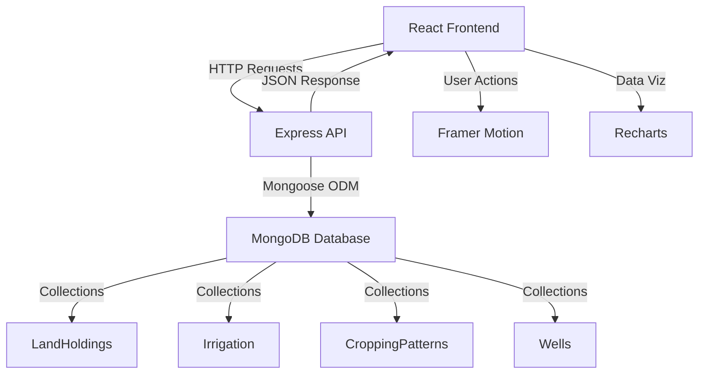

<div align="center">

# 🌾 AgriStats
### Agricultural Land Assessment & Analytics Platform

<p align="center">
  
  
  
  
</p>

<p align="center">
  
  
  
  
</p>

<h3>A comprehensive full-stack MERN application for monitoring and analyzing agricultural data across India</h3>

[Features](#-features) • [Demo](#-demo) • [Installation](#-installation) • [Tech Stack](#-tech-stack) • [API](#-api-documentation) • [Screenshots](#-screenshots)

---

</div>

## 📋 Table of Contents

- [Overview](#-overview)
- [Features](#-features)
- [Demo](#-demo)
- [Tech Stack](#-tech-stack)
- [Architecture](#-architecture)
- [Installation](#-installation)
- [Usage](#-usage)
- [API Documentation](#-api-documentation)
- [Screenshots](#-screenshots)
- [Project Structure](#-project-structure)
- [Database Schema](#-database-schema)
- [Contributing](#-contributing)
- [License](#-license)

---

## 🌟 Overview

**AgriStats** is a modern, full-stack web application designed to revolutionize agricultural data management in India. Built with the MERN stack, it provides an intuitive platform for:

- 📊 **Real-time monitoring** of land holdings across different states
- 💧 **Irrigation source tracking** with efficiency metrics
- 🌱 **Cropping pattern analysis** by season and type
- 🚰 **Well depth assessment** with water quality indicators

### 🎯 Problem Statement

Agricultural planning in India requires comprehensive data on:
- Land holding patterns and distribution
- Source and efficiency of irrigation systems
- Seasonal cropping patterns and yields
- Well depth and water availability across regions

### 💡 Solution

AgriStats provides a centralized platform with:
- ✅ Easy data entry through intuitive forms
- ✅ Real-time dashboard with animated statistics
- ✅ Interactive charts and visual analytics
- ✅ Responsive design for field data collection
- ✅ Dark/Light theme for different lighting conditions

---

## ✨ Features

### 🎨 User Interface
- 🌓 **Theme Toggle** - Seamless dark/light mode with smooth animations
- 📱 **Fully Responsive** - Perfect experience on mobile, tablet, and desktop
- ✨ **Smooth Animations** - Powered by Framer Motion for delightful UX
- 🎯 **Intuitive Navigation** - Easy-to-use interface with clear workflows

### 📊 Dashboard
- 📈 **Real-time Statistics** - Animated stat cards with trend indicators
- 🗺️ **State-wise Distribution** - Geographic analysis of land holdings
- 💰 **Aggregate Metrics** - Total areas, averages, and counts
- 🔄 **Auto-refresh** - Live data updates without page reload

### 📝 Data Entry
- 📋 **Multi-category Forms** - Land, Irrigation, Crops, and Wells
- ✅ **Input Validation** - Prevent invalid data entry
- 🎯 **Smart Dropdowns** - Predefined options for consistency
- 📍 **GPS Coordinates** - Optional location tracking
- 🔔 **Toast Notifications** - Instant feedback on actions

### 📈 Analytics & Reports
- 📊 **Pie Charts** - Land distribution by type
- 📉 **Bar Charts** - Irrigation sources and crop areas
- 📈 **Line Graphs** - Well depth trends
- 🖱️ **Interactive** - Hover tooltips and clickable legends
- 📑 **Report Summaries** - Key insights and statistics

### 🔧 Technical Features
- 🚀 **RESTful API** - Clean, well-documented endpoints
- 🗄️ **MongoDB Integration** - Scalable NoSQL database
- 🔄 **CRUD Operations** - Complete data management
- ⚡ **Fast Performance** - Optimized queries and rendering
- 🛡️ **Error Handling** - Graceful error management
- 📦 **Modular Code** - Easy to maintain and extend

---

## 🎬 Demo

### Live Application Flow

1. **Landing on Dashboard** → See animated statistics and overview
2. **Toggle Theme** → Click sun/moon icon for instant theme switch
3. **Add New Data** → Navigate to Data Entry, fill form, submit
4. **View Updates** → Return to Dashboard to see new data reflected
5. **Analyze Trends** → Check Reports for visual analytics

### Quick Start
```bash
# Backend
cd backend && npm run dev

# Frontend (new terminal)
cd frontend && npm start

# Open browser
http://localhost:3000
```

---

## 🛠️ Tech Stack

<table>
<tr>
<td width="50%">

### 🎨 Frontend
| Technology | Purpose |
|-----------|---------|
|  | UI Framework |
|  | Navigation & Routing |
|  | Animations |
|  | Data Visualization |
|  | HTTP Client |
|  | Icon Library |

</td>
<td width="50%">

### ⚙️ Backend
| Technology | Purpose |
|-----------|---------|
|  | Runtime Environment |
|  | Web Framework |
|  | Database |
|  | ODM Library |
|  | Cross-Origin Support |

</td>
</tr>
</table>

---

## 🏗️ Architecture



### Data Flow
1. **User Input** → React Form Components
2. **Form Submit** → Axios HTTP Request
3. **API Endpoint** → Express Route Handler
4. **Controller** → Business Logic Processing
5. **Mongoose Model** → MongoDB CRUD Operation
6. **Response** → JSON Data Back to Frontend
7. **State Update** → React Re-renders with New Data
8. **UI Animation** → Framer Motion Transitions

---

## 📥 Installation

### Prerequisites

Ensure you have the following installed:
- **Node.js** (v14+) - [Download](https://nodejs.org/)
- **MongoDB** (v4.4+) - [Download](https://www.mongodb.com/try/download/community)
- **npm** or **yarn**
- **Git** (optional)

### Step-by-Step Setup

#### 1️⃣ Clone or Download Repository
```bash
# If using Git
git clone https://github.com/yourusername/agristats.git
cd agristats

# Or download and extract ZIP
```

#### 2️⃣ Install Backend Dependencies
```bash
cd backend
npm install
```

**Backend packages installed:**
- express, mongoose, cors, dotenv, body-parser, nodemon

#### 3️⃣ Configure Environment
Create `.env` file in `backend/` directory:
```env
PORT=5000
MONGODB_URI=mongodb://localhost:27017/agriculture_assessment
NODE_ENV=development
```

#### 4️⃣ Start MongoDB
```bash
# Windows
net start MongoDB

# macOS/Linux
sudo systemctl start mongod

# Or use MongoDB Atlas (cloud)
# Update MONGODB_URI with your connection string
```

#### 5️⃣ Start Backend Server
```bash
npm run dev
```
✅ Backend running at `http://localhost:5000`

#### 6️⃣ Install Frontend Dependencies
Open **new terminal**:
```bash
cd frontend
npm install
```

**Frontend packages installed:**
- react, react-router-dom, axios, framer-motion, recharts, react-icons, react-toastify

#### 7️⃣ Start Frontend Application
```bash
npm start
```
✅ Frontend running at `http://localhost:3000`

### 🎉 Success!
Your application should now be running:
- Frontend: http://localhost:3000
- Backend: http://localhost:5000
- Database: MongoDB connected

---

## 🚀 Usage

### Adding Land Holding Data

1. Navigate to **Data Entry** page
2. Select **Land Holding** tab
3. Fill in the form:
   - State, District, Village
   - Farmer Name
   - Land Size (in acres)
   - Land Type (Marginal/Small/Medium/Large)
   - Soil Type
   - GPS Coordinates (optional)
4. Click **Submit**
5. See success notification!

### Viewing Dashboard

1. Click **Dashboard** in navigation
2. View animated stat cards showing:
   - Total land holdings
   - Irrigation sources
   - Cropping patterns
   - Wells registered
3. Scroll down for state-wise distribution
4. See aggregate area calculations

### Analyzing Reports

1. Navigate to **Reports** page
2. Explore interactive charts:
   - **Pie Chart**: Land distribution by type
   - **Bar Charts**: Irrigation sources, crop areas
   - **Line Graph**: Average well depths
3. Hover over chart elements for detailed info
4. Review summary statistics below

### Theme Toggle

- Click **sun/moon icon** in top-right navbar
- Theme smoothly transitions between light/dark
- Preference saved in browser localStorage
- All colors, shadows, and contrasts adjust automatically

---

## 📡 API Documentation

### Base URL
```
http://localhost:5000/api
```

### Endpoints

<details>
<summary><b>🏞️ Land Holdings</b></summary>

#### Get All Lands
```http
GET /api/lands
```
Response:
```json
{
  "success": true,
  "count": 10,
  "data": [...]
}
```

#### Create Land Holding
```http
POST /api/lands
Content-Type: application/json

{
  "state": "Punjab",
  "district": "Ludhiana",
  "village": "Khurana",
  "farmerName": "Rajesh Kumar",
  "landSize": 5.5,
  "landType": "Medium (4-10 acres)",
  "soilType": "Alluvial"
}
```

#### Get Single Land
```http
GET /api/lands/:id
```

#### Update Land
```http
PUT /api/lands/:id
```

#### Delete Land
```http
DELETE /api/lands/:id
```

#### Get Statistics
```http
GET /api/lands/stats
```

</details>

<details>
<summary><b>💧 Irrigation Sources</b></summary>

#### Get All Irrigation
```http
GET /api/irrigation
```

#### Create Irrigation
```http
POST /api/irrigation
Content-Type: application/json

{
  "state": "Maharashtra",
  "district": "Pune",
  "village": "Shivajinagar",
  "irrigationSource": "Drip Irrigation",
  "irrigatedArea": 5.0,
  "efficiency": 85,
  "waterAvailability": "Sufficient"
}
```

#### CRUD Operations
```http
GET    /api/irrigation/:id
PUT    /api/irrigation/:id
DELETE /api/irrigation/:id
GET    /api/irrigation/stats
```

</details>

<details>
<summary><b>🌾 Cropping Patterns</b></summary>

#### Get All Crops
```http
GET /api/cropping
```

#### Create Crop
```http
POST /api/cropping
Content-Type: application/json

{
  "state": "Punjab",
  "district": "Amritsar",
  "village": "Majitha",
  "cropName": "Wheat",
  "cropType": "Rabi",
  "cropCategory": "Cereals",
  "areaCultivated": 4.0,
  "season": "Winter",
  "year": 2025
}
```

#### CRUD Operations
```http
GET    /api/cropping/:id
PUT    /api/cropping/:id
DELETE /api/cropping/:id
GET    /api/cropping/stats
```

</details>

<details>
<summary><b>🚰 Wells</b></summary>

#### Get All Wells
```http
GET /api/wells
```

#### Create Well
```http
POST /api/wells
Content-Type: application/json

{
  "state": "Rajasthan",
  "district": "Jaipur",
  "village": "Sanganer",
  "wellType": "Bore Well",
  "depth": 200,
  "waterLevel": 80,
  "waterQuality": "Good",
  "status": "Active"
}
```

#### CRUD Operations
```http
GET    /api/wells/:id
PUT    /api/wells/:id
DELETE /api/wells/:id
GET    /api/wells/stats
```

</details>

<details>
<summary><b>📊 Dashboard</b></summary>

#### Get Overall Statistics
```http
GET /api/dashboard/stats
```

Response:
```json
{
  "success": true,
  "data": {
    "counts": {
      "lands": 15,
      "irrigation": 12,
      "crops": 20,
      "wells": 8
    },
    "totals": {
      "landArea": 125.50,
      "irrigatedArea": 98.30,
      "cropArea": 110.25
    },
    "averages": {
      "wellDepth": 175.50
    },
    "stateWise": [...]
  }
}
```

</details>

---

## 📸 Screenshots

<div align="center">

### Dashboard - Light Theme
*Real-time statistics with animated stat cards and state-wise distribution*

### Dashboard - Dark Theme
*Same great features with dark mode for comfortable night viewing*

### Data Entry Form
*Intuitive forms with validation for easy data collection*

### Analytics & Reports
*Beautiful interactive charts powered by Recharts*

</div>

---

## 📁 Project Structure

```
ca2/
├── backend/
│   ├── controllers/          # Request handlers
│   ├── models/              # MongoDB schemas
│   ├── routes/              # API routes
│   ├── server.js            # Entry point
│   ├── package.json
│   └── .env                 # Environment variables
│
└── frontend/
    ├── public/
    │   └── index.html
    ├── src/
    │   ├── components/      # Reusable components
    │   ├── context/         # React context (Theme)
    │   ├── pages/           # Main pages
    │   ├── services/        # API services
    │   ├── App.js
    │   ├── index.js
    │   └── index.css
    └── package.json
```

## 🏃‍♂️ Getting Started

### Prerequisites
- Node.js (v14 or higher)
- MongoDB (v4.4 or higher)
- npm or yarn

### Installation Steps

#### 1️⃣ Install MongoDB (if not installed)

**Windows:**
- Download from: https://www.mongodb.com/try/download/community
- Install and run MongoDB as a service

**Or use MongoDB Cloud (Atlas):**
- Sign up at: https://www.mongodb.com/cloud/atlas
- Create a free cluster
- Get connection string

#### 2️⃣ Backend Setup

```powershell
# Navigate to backend directory
cd e:\ca2\backend

# Install dependencies
npm install

# Start the backend server
npm run dev
```

Backend will run on: **http://localhost:5000**

#### 3️⃣ Frontend Setup

Open a **NEW** terminal window:

```powershell
# Navigate to frontend directory
cd e:\ca2\frontend

# Install dependencies
npm install

# Start the React app
npm start
```

Frontend will run on: **http://localhost:3000**

## 🔧 Configuration

### Backend (.env file)
```
PORT=5000
MONGODB_URI=mongodb://localhost:27017/agriculture_assessment
NODE_ENV=development
```

### MongoDB Connection
- **Local:** `mongodb://localhost:27017/agriculture_assessment`
- **Cloud:** Replace with your MongoDB Atlas connection string

## 📖 Usage Guide

### 1. Dashboard Page
- View overall statistics
- Monitor total land holdings, irrigation sources, crops, and wells
- See state-wise distribution
- Track key metrics with animated stat cards

### 2. Data Entry Page
- Switch between 4 tabs: Land, Irrigation, Cropping, Wells
- Fill in the forms with required data
- Submit to add new records
- Get instant success/error notifications

### 3. Reports Page
- Visualize data with interactive charts
- Pie charts, bar charts, and line graphs
- Analyze patterns and trends
- Export-ready reports

### 4. Theme Toggle
- Click the sun/moon icon in the navbar
- Smoothly switch between light and dark themes
- Preference saved in local storage

## 🎨 Key Components

### StatCard
Animated statistics card with icon, value, and trend indicator

### LoadingSpinner
Beautiful loading animation with leaf icons

### Navbar
Responsive navigation with theme toggle and smooth animations

## 🗃️ Database Models

### LandHolding
- State, District, Village
- Farmer name, Land size
- Land type, Soil type
- GPS coordinates

### Irrigation
- Location details
- Irrigation source type
- Irrigated area
- Water availability status

### CroppingPattern
- Location details
- Crop name and type
- Crop category
- Area cultivated
- Expected yield

### Well
- Location details
- Well type
- Depth and water level
- Water quality
- Status (Active/Inactive)

## 🔌 API Endpoints

### Land Holdings
- `GET /api/lands` - Get all land holdings
- `POST /api/lands` - Create new land holding
- `GET /api/lands/:id` - Get specific land holding
- `PUT /api/lands/:id` - Update land holding
- `DELETE /api/lands/:id` - Delete land holding
- `GET /api/lands/stats` - Get statistics

### Similar endpoints for:
- `/api/irrigation`
- `/api/cropping`
- `/api/wells`
- `/api/dashboard/stats` - Overall dashboard statistics

## 🎯 Sample Data Entry

### Example Land Holding:
```json
{
  "state": "Punjab",
  "district": "Ludhiana",
  "village": "Khurana",
  "farmerName": "Rajesh Kumar",
  "landSize": 5.5,
  "landType": "Medium (4-10 acres)",
  "soilType": "Alluvial"
}
```

## 🐛 Troubleshooting

### Backend won't start
- Ensure MongoDB is running
- Check if port 5000 is available
- Verify .env file configuration

### Frontend won't start
- Delete node_modules and package-lock.json
- Run `npm install` again
- Check if port 3000 is available

### Database connection error
- Verify MongoDB is running: `mongod --version`
- Check connection string in .env
- Ensure MongoDB service is started

### CORS errors
- Backend CORS is configured to allow all origins
- Check if backend is running on port 5000

## 📝 Testing the Application

1. **Start both servers** (backend & frontend)
2. **Open browser:** http://localhost:3000
3. **Test theme toggle:** Click sun/moon icon
4. **Add data:** Go to Data Entry → Fill form → Submit
5. **View dashboard:** Check updated statistics
6. **Check reports:** View charts and visualizations

## 🎨 Color Palette

- **Primary Green:** #10b981
- **Secondary Blue:** #3b82f6
- **Tertiary Orange:** #f59e0b
- **Purple:** #8b5cf6
- **Danger Red:** #ef4444
- **Cyan:** #06b6d4

## 🚀 Deployment (Production)

### Backend (Heroku/Railway/Render)
1. Push code to GitHub
2. Connect to hosting platform
3. Set environment variables
4. Deploy

### Frontend (Vercel/Netlify)
1. Run `npm run build`
2. Upload build folder
3. Configure API URL
4. Deploy

### MongoDB (Atlas)
1. Use MongoDB Atlas for cloud database
2. Update connection string in .env

## 📄 License

This project is for educational purposes.

## 👨‍💻 Author

Created as part of CA2 assignment

## 🙏 Acknowledgments

- React team for amazing framework
- MongoDB team for excellent database
- Recharts for beautiful visualizations
- Framer Motion for smooth animations

---

## ⚡ Quick Start Commands

```powershell
# Terminal 1 - Backend
cd e:\ca2\backend
npm install
npm run dev

# Terminal 2 - Frontend
cd e:\ca2\frontend
npm install
npm start
```

## 📞 Support

If you encounter any issues:
1. Check this README
2. Verify all dependencies are installed
3. Ensure MongoDB is running
4. Check console for errors

---

**Good luck with your project! 🌟**
